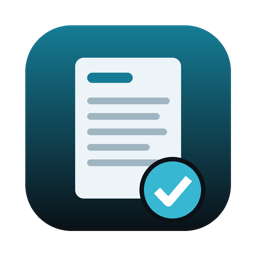
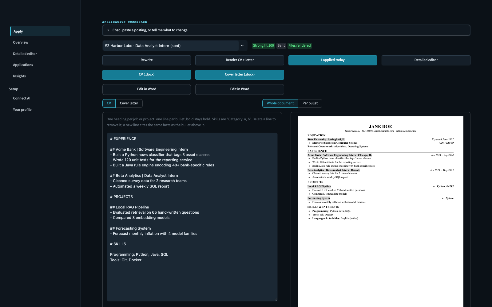
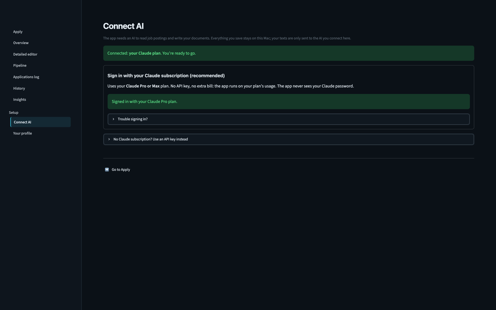
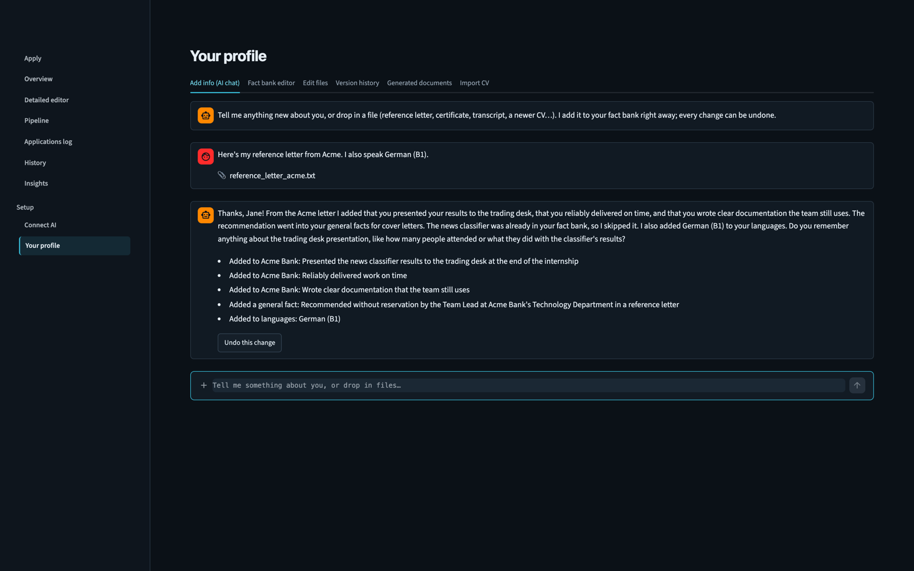
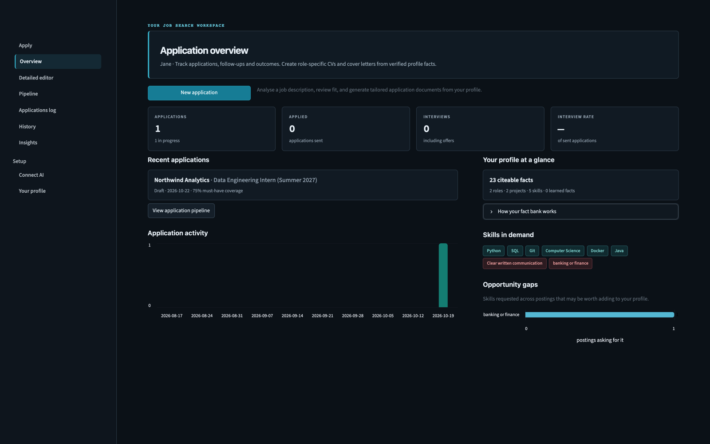
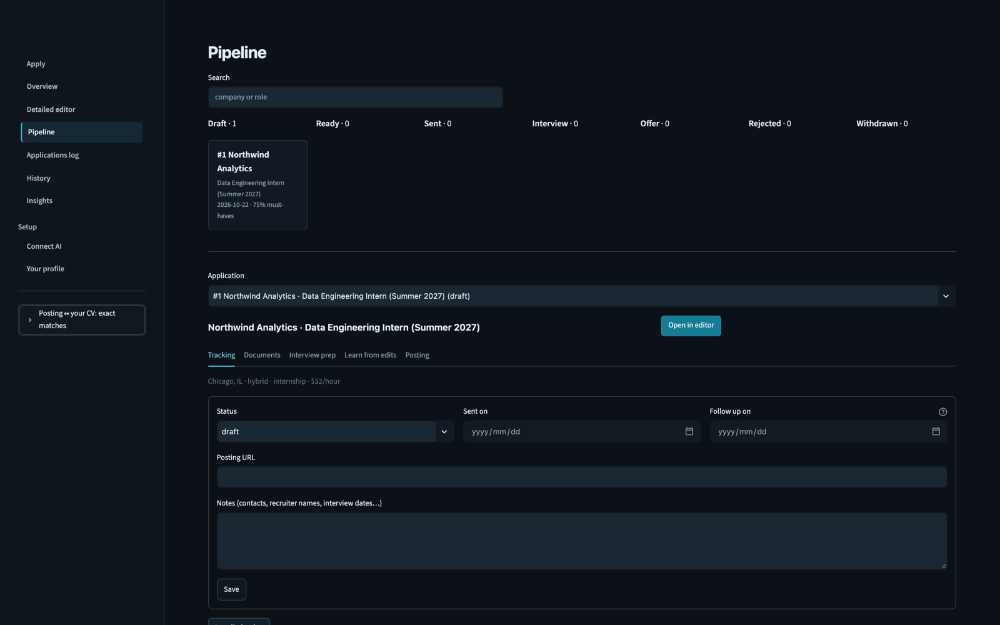

<p align="center"></p>

# CV Drafter

Paste a job posting and get a CV and cover letter tailored to it, written **only from true facts about you**. Every
sentence cites the fact it came from, rule checks in code and an AI fact-checker verify it, and nothing is rendered
until the check passes. The design of your documents stays fixed. It also tracks every application and learns from
your edits.

<p align="center">
  <a href="https://github.com/Max-1902/cv-drafter/releases/latest/download/CV-Drafter-mac.zip"><b>⬇ Download for Mac</b></a>
  &nbsp;·&nbsp; macOS 12 or newer · Apple Silicon and Intel
</p>



## Get started (2 minutes)

1. **Download** [CV-Drafter-mac.zip](https://github.com/Max-1902/cv-drafter/releases/latest/download/CV-Drafter-mac.zip),
   open it, and drag **CV Drafter** into Applications.
2. **Double-click CV Drafter.** The first start sets itself up (about 2 minutes, needs internet); after that it opens
   in seconds. macOS asks once because the app isn't from the App Store: click *Done*, then go to
   *System Settings → Privacy & Security* and click **Open Anyway**.

   Prefer no warning? Paste this into Terminal instead; it downloads and opens the same app:
   ```bash
   curl -fsSL https://raw.githubusercontent.com/Max-1902/cv-drafter/main/install.sh | bash
   ```
3. **Connect AI:** click *Install Claude*, then *Sign in with Claude* and log in with your **Claude Pro or Max**
   account. No API key, no extra bill: it runs on your plan.
4. **Your profile:** drop your CV into the chat. Add anything else the same way (reference letters, certificates,
   transcripts) or just type it: *"I also tutored maths for two years"*.
5. **Apply:** paste a job posting, say *write it*, download your CV and cover letter.

To stop it, click **Quit CV Drafter** at the bottom of the left menu.

### Your history is yours alone

The download contains only code, so everyone starts with an empty app. As you use it, it builds your own history:
your fact bank, every application and its status, your chats, learned style rules and every CV and cover letter it
writes. All of it lives on your Mac in `~/Library/Application Support/CV Drafter`.

- **Nothing is uploaded or shared.** The app has no account, sync or analytics. No one else who uses CV Drafter,
  including whoever sent it to you, can see your data. The only thing that leaves your Mac is the text sent to the AI
  you connect (Claude, Anthropic or OpenRouter).
- **Updates keep it.** Closing the app or installing a newer version never touches your data, keys or documents.
- **Start over anytime.** Quit the app and delete `~/Library/Application Support/CV Drafter/data` (and `output` for the
  generated documents). The next start is a fresh install.

| Connect your Claude plan | Add facts by chatting or dropping files |
|---|---|
|  |  |
| **Overview** | **Pipeline** |
|  |  |

<sub>Screenshots show the fictional test profile "Jane Doe".</sub>

## Models

The app is built and tested for **Claude Sonnet**, which writes and fact-checks; Haiku turns short chat commands into
actions. Common commands (*applied*, *status interview*, *pdf*) need no AI at all.

- **Claude Pro / Max (recommended):** runs through Claude Code on your plan's usage.
- **OpenRouter or Anthropic API key:** pay per use, usually a few cents per application. It still uses Sonnet by
  default. You *can* switch to other models, but your CVs and letters get noticeably worse and the fact-check can miss
  mistakes; the app warns you and offers a one-click reset.

## How it stays honest

1. **Fact bank** (`data/profile.yaml`): every true fact about you, each with an id. The AI only *selects and rewords* these.
2. **Citations**: every bullet and paragraph must name the fact ids it came from. A bullet for one job can't use another job's facts.
3. **Locked fields**: names, titles, dates, education, contact details and skill names come from your profile, never from the AI.
4. **Rule-based checks** (code, not AI): numbers must appear in the cited facts. Keywords from the posting that aren't
   in your profile are blocked. Skills can only be reordered, never added. Never-mention terms, banned phrases,
   length limits and the cover-letter word count are all checked. Cover-letter paragraphs are checked for how true
   facts are put together: one project per paragraph, no fact or opinion next to a different project's work (tag a
   general fact with `about: <entry id>` to tie it to one), no coursework list and no "finishing my degree" when
   graduation is more than six months away.
5. **AI fact-checker**: a separate AI pass compares each statement with its sources and your claim guards
   (`data/guardrails.yaml`).
6. **Fix loop**: problems go back to the writer automatically (`MAX_FIX_ROUNDS`). Anything left over is shown to you.
7. **Per-job limits**: `never_mention_for` in `guardrails.yaml` lists words that must never be said about one job
   (e.g. anything beyond what a reference letter in `data/references/` confirms). Enforced in code.
8. **Render gate**: every render re-checks the exact text going into the file (rules + AI fact-check). If errors remain,
   nothing is rendered. "Render anyway" exists, but the render is then marked as overridden.
9. **History and flags**: each render keeps its check result (✅ verified, 🟡 warnings, ❔ AI check didn't run,
   ⛔ rendered despite errors). Flag a problem on any render; tick the box and it becomes a rule for every future draft.

## Privacy

- The dashboard only listens on `localhost` (`.streamlit/config.toml`), so other devices on your network can't open it.
- When you run from source, the whole `data/` folder, `output/` and `.env` are in `.gitignore`, so your personal files
  can't be committed. The tests use the fictional profile in `tests/fixtures/`.
- AI requests go only to the provider you connected. With OpenRouter, only to providers that don't store or train on
  your data (`data_collection: deny`).
  The CV importer removes your email and phone number before sending the text.
- Text from job postings and the AI is escaped before it is shown, so a malicious posting can't inject HTML or
  images that would send your data to another site.

## Fit verdict

Every pasted posting gets a verdict (Strong fit, Good fit, Stretch or Not a fit) and a 0–100 score at the top right of the Apply page and in the Detailed editor. The AI only maps each requirement to your facts; the verdict itself is fixed logic in `cvdrafter/fit.py`, so it's the same every time and you can see why:

- Must-haves count 3x, nice-to-haves 1x, soft skills half.
- Direct evidence earns full credit. A fair interpretation (four years of varsity sport for discipline) earns 80%, partial evidence 50%.
- Logistics (location, dates, graduation window, work authorization) are pass/fail: a missed must-have, or a mid/senior role, makes it Not a fit.
- Strong fit needs every must-have met; one missing hard must-have caps it at Good, two at Stretch.

If the AI undersells you, open "Why this verdict" and confirm that one of your facts shows a skill or trait (team captain → leadership). It's saved in `data/interpretations.yaml` and from then on every requirement that names it counts as met. Interpretations only affect the verdict: your CV and letter still say only what your facts say.

## More on the Apply page

- **Duplicate postings**: paste a posting (or link) you already have and the app opens the existing application instead of logging and analysing it again. The same company and role from a different posting is flagged too.
- **Application questions**: paste a form's questions ("Why this role? (max 500 characters)") and get short answers written from your facts in your letter's voice, checked like the letter and kept within each question's limit.
- **Ask AI to change something** (Detailed editor): edit the CV and letter texts from a chat message, only within each text's cited facts. The fact check re-runs, and you can undo it.

## How the design stays fixed

`templates/cv_template.docx` recreates your CV's design with text slots. The AI only fills those slots, so it can't
change fonts, layout or sections. Per-slot character limits and per-job bullet caps keep the CV on one page, and the
app warns you if the PDF runs longer. You can restyle the template in Word as long as you keep the `{{ }}` tags.
`scripts/make_templates.py` rebuilds the default.

## How it improves with every application

- **Approved examples**: what you actually send becomes a style example for similar postings. Applications that got
  interviews count more.
- **Learned style rules**: Pipeline → *Learn from edits* turns your edits into rules in `data/style_rules.md`.
- **Gap answers**: when a posting asks for something missing from your profile and you really have it, add it as a fact.
  It's saved in `data/learned_facts.yaml` and used from then on.
- **Insights**: the keywords postings ask for most, your gap radar, and which facts end up in interviews.

## Files (in the app's data folder)

```
data/profile.yaml        your fact bank (edit it on the Your profile page)
data/guardrails.yaml     never-mention terms, banned phrases, claim guards
data/style_rules.md      voice and structure rules (grows over time)
data/learned_facts.yaml  facts added from gap questions
data/interpretations.yaml  traits you confirmed a fact shows (fit verdict only)
data/applications.db     history (SQLite)
data/.versions/          automatic backups of every file you edit in the app
templates/               cv_template.docx, cl_template.docx, slots.yaml (layout limits)
data/references/         documents that cap what may be said (e.g. a reference letter)
output/                  generated CVs and cover letters: one folder per application, one subfolder per render
```

## Automatic logging

Every analysed posting is saved to `data/applications.db` with the details the AI pulls from it: company, role,
location, work mode, employment type, salary, deadline and job id. Click **📨 I applied today** and it's marked sent,
dated, and gets a follow-up reminder 7 days later. Each status change is written to an `events` table, which is
the timeline on the Pipeline page.

**Finding the company.** Leave the Company field empty and the AI names the employer, quoting where it found it.
It's told never to answer with an ATS or job board (Greenhouse, Workday, LinkedIn…). Code then checks that name
against the posting and URL. If the name isn't there, the app uses the careers URL instead
(`boards.greenhouse.io/<x>`, `jobs.lever.co/<x>`, `<x>.wd5.myworkdayjobs.com`, `careers.<x>.com`, …) or the
posting's own wording ("About X", "X is an equal opportunity employer"). Each row gets a ✅ / 🟡 / ❌ confidence
mark in the log, so the rare guess is easy to spot and fix.

## PDF export

The app uses Microsoft Word. It converts inside Word's sandbox folder, so macOS doesn't block it with a file-access
prompt. The first time, macOS may ask whether Terminal (or Python) may control Microsoft Word. Click **Allow**.

## Run from source

```bash
git clone https://github.com/Max-1902/cv-drafter && cd cv-drafter
./run.sh              # needs uv (https://docs.astral.sh/uv/); opens http://localhost:8501
.venv/bin/python -m pytest -q
./packaging/build_app.sh   # builds dist/CV Drafter.app and the download zip
```

How the pieces fit together: [architecture.md](architecture.md).
